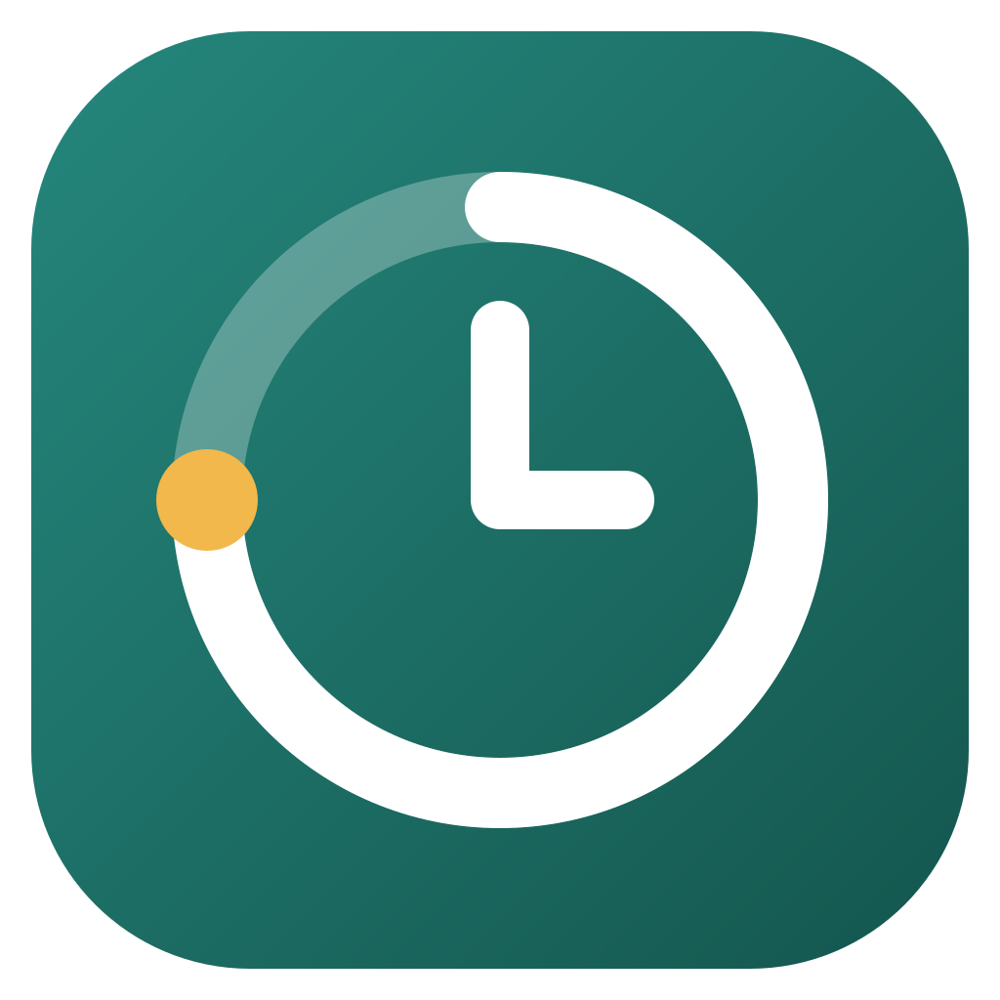
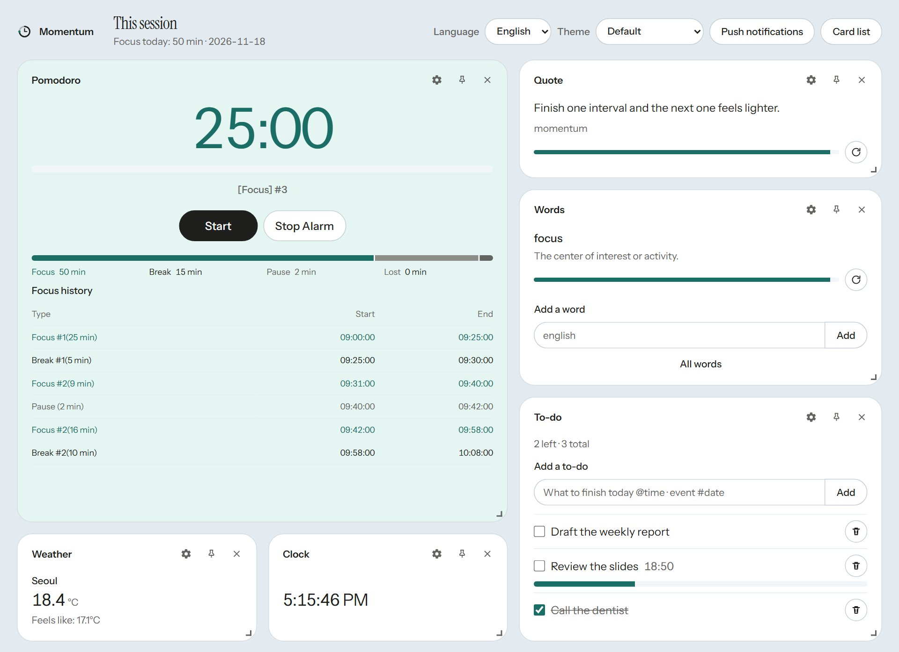
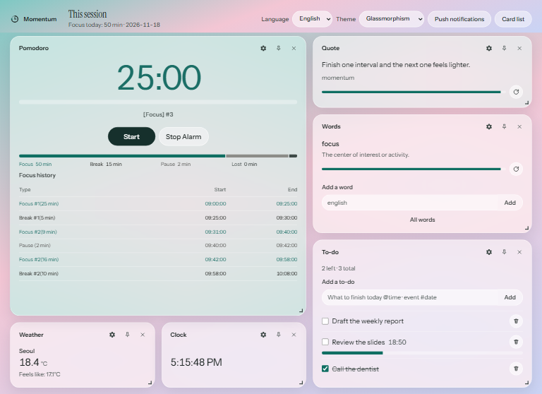
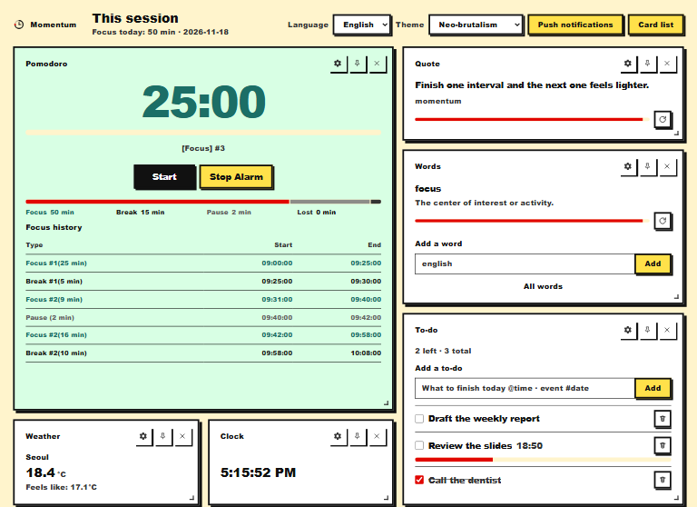
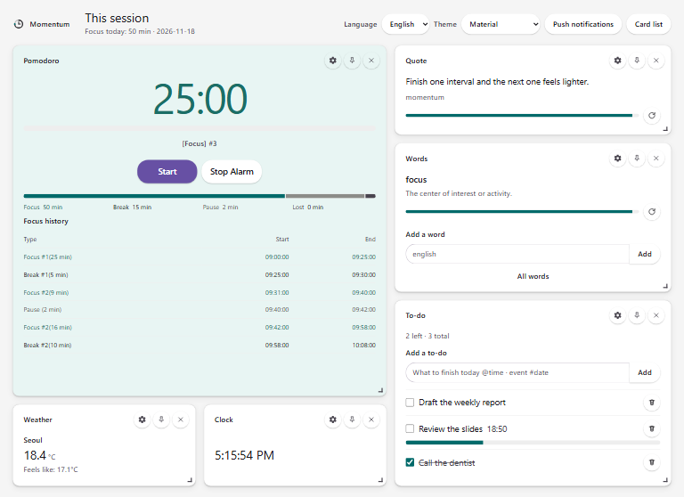

<p align="center">
  <a href="README.md">한국어</a> · <b>English</b>
</p>

<p align="center">
  
</p>

<h1 align="center">Momentum</h1>

<p align="center">
  <strong>Your day's focus, on one screen.</strong><br>
  A focus board that lays out a Pomodoro timer, to-dos, weather, a clock, quotes, and English words as cards.
</p>

<p align="center">
  <a href="https://elkeipy.github.io/momentum_card/"><b>Open in your browser</b></a> ·
  <a href="https://github.com/elkeipy/momentum_card/releases/latest">Get the Windows app</a> ·
  <a href="CHANGELOG.md">Changelog (Korean)</a>
</p>

<p align="center">
  <a href="https://github.com/elkeipy/momentum_card/actions/workflows/ci.yml"></a>
</p>

<p align="center">
  
</p>

> The interface is available in English and Korean. It follows your browser's language, and you can switch it with **Language** at the top right.

## Why Momentum

- **No sign-up.** No account, no server. Card layout, to-dos, and focus history stay in the browser you use.
- **Everything on one screen.** The focus timer, today's to-dos, the weather, and the clock share one board. No tab hopping.
- **Arrange it your way.** Drag and resize cards, and close the ones you don't need. There are ten themes.
- **Two languages.** The interface comes in English and Korean. It follows your browser's language, and you switch it with **Language** at the top right.
- **Light.** It is a small static page. Even as a Windows app, all of its processes together used about 110–130 MB (private working set, measured on one development PC).

## Cards

| Card | What it does |
|---|---|
| **Pomodoro** | Focus/break timer and today's focus history. Defaults: 25 min focus, 5 min short break, 15 min long break. |
| **To-do** | Write what you want to finish today. `@` sets a deadline alert; `#` creates a Google Calendar event and keeps it on the list. |
| **Weather** | City, temperature, and feels-like temperature for your location, refreshed every hour. |
| **Clock** | Shows this device's time. |
| **Quote** | Five short lines that rotate every minute. Refresh to skip ahead. |
| **Words** | An English word and its meaning, shuffled every minute. The list holds up to 20 words. |

Change the font size from the gear icon in each card header. The − / + buttons preview the value on the card before you save. Quote and Word also let you change the refresh interval.

## Pomodoro: keep a record of how your focus was spent

- **Fit the intervals to your rhythm.** In settings, choose focus 1–60 min, break 1–30 min, and a long-break interval of 1–10 sessions. A long break comes after every 4 focus sessions by default.
- **Pause and pick up.** Pause keeps the remaining time, and Start resumes from there. The bar under the time fills as the interval passes and stops in place on Pause.
- **Time keeps counting after it ends.** When the timer reaches 0 it counts the elapsed time as `+m:ss`. If you don't start the next interval within a minute, that time is recorded as **Lost**.
- **See your day as one strip.** Today's Focus, Break, Pause, and Lost are split into one color-coded track, with the interval list below it.

  ```
  Focus #1(25 min)   Break #1(5 min)   Focus #2(9 min)   Pause (2 min)   Focus #2(16 min)   Lost (10 s)
  ```

  Focus and Break show which term of the day it is plus its length; Pause and Lost show only the length. A term interrupted by Pause keeps the same number. Lengths up to one minute are written in seconds; longer ones in minutes and seconds, like `1 min 2 s`. Time you paused during Focus or Break is added to the history when that term ends.
- **Tell them apart at a glance.** The card background changes with Focus, Break, and Lost. Pick text colors for Focus, Break, Pause, and Lost to apply them to the timer and the history.
- **Grow the card, grow the history.** The timer stays as it is; only the history table gets longer.

## To-do: write it and it becomes a deadline or an event

- **`@` sets a deadline.** Type `@` in the input to pick a deadline hour and minute. A time earlier than now can't be entered. An item with a deadline shows a bar that fills over time. If the time arrives and the item isn't done, the bar turns red, a notice stacks at the bottom right, and a Mixkit alert sound plays.
- **`#` creates an event.** Type `#`, pick a date and time (leave the time blank for all-day), and press **Add to Calendar**. The Google Calendar event editor opens with the title and time filled in, using the account signed in to that browser, and you press save yourself. The app never accesses your Google account.
- **Events stay on the list too.** An event made with `#` is also added to the to-do list. Its day and time follow the text, like `Today, 14:30`, `Tomorrow, all day`, or `Dec 2, 09:00`, and a bar fills from when you added it until the event starts. It fills continuously rather than in hour or day steps. If the event has passed and you haven't checked it off, the bar turns red (for an all-day event, once that day ends). Events don't ring an alarm; Google Calendar handles reminders.
- **Edit in place.** Double-click the text to edit it on that line. Enter saves and Esc cancels. Long text is ellipsized and shows in full on hover. Delete with the trash button. The list holds up to 40 items.

## Phone notifications too

Enter an [ntfy](https://ntfy.sh) topic under **Push notifications** at the top right, and the app sends one line to `https://ntfy.sh/<topic>` when a Pomodoro interval ends or a to-do deadline passes. Subscribe to the same topic in the ntfy phone app (or at ntfy.sh/app). Messages go out only while the board tab is open. The topic name works as the password, so make it long.

## Arrange the board your way

- **Drag, resize, snap.** Drag a header to move a card and the bottom-right corner to resize it. An edge within 8 px of another card's edge, or of the gap spot next to it, snaps to that line. Positions are remembered.
- **Pin, close, bring back.** Pinning locks moving and resizing. Closing only hides a card from the screen; turn it back on from **Card list** at the top right, and it comes to the front.
- **Pick a language.** **Language** at the top right switches between English and Korean. At first it is Korean only when your browser's first language is Korean, and English otherwise. Your choice is remembered. The city name in the weather card, the clock format, and the push notification text follow it too.
- **Ten themes.** Default, Skeuomorphism, Flat, Material, Neumorphism, Glassmorphism, Claymorphism, Neo-brutalism, Liquid Glass, and 3D Icons. Your choice is remembered.

| Glassmorphism | Neo-brutalism | Material |
|:---:|:---:|:---:|
|  |  |  |

### Shortcuts

| Key | Action |
|---|---|
| `Alt+S` | Start / pause the Pomodoro (works while the cursor is in a text field) |
| `Alt+A` | Stop the Pomodoro alarm sound (works while the cursor is in a text field) |
| `Alt+T` | Put the cursor in the to-do input |
| `Esc` | Close settings or the card list; cancel editing a to-do; release the cursor from the to-do input |

## Your data stays yours

There are no accounts. Card layout, visible cards, timer settings, today's focus history, the word list, to-dos, the ntfy topic, the theme, and the language all live only in this browser's `localStorage`. Nothing syncs to other devices.

These are the only requests that leave your machine:

| Request | When | What is sent |
|---|---|---|
| `api.open-meteo.com` | Weather card | Latitude and longitude rounded to two decimals |
| `api.bigdatacloud.net` | Weather card | The same coordinates and the interface language code (returns the city name in that language) |
| `api.dictionaryapi.dev` | Word card | The English word being shown |
| `ntfy.sh` | Only when push notifications are on | One line of notification text |
| Google Fonts | When the page opens | Font file requests |

## Getting started

### Web

Open [elkeipy.github.io/momentum_card](https://elkeipy.github.io/momentum_card/). The weather card asks for location permission once.

### Windows app

A Tauri app that runs in a small window without Chrome. Download `momentum.exe` from the Assets on the [Releases](https://github.com/elkeipy/momentum_card/releases/latest) page and run it. No installation is needed.

- The WebView2 runtime built into Windows opens the deployed page as is, so the app is up to date whenever the site is. Without an internet connection nothing is shown. The WebView2 runtime is required (it comes preinstalled on Windows 11).
- Window size and position are saved on a normal close and restored on the next launch. If you close it maximized, it opens maximized.
- The Google Calendar event editor opens in your PC's default browser, using the account signed in there. No other new windows are opened.
- Location permission is granted only to requests from the app's own address. If Windows location services are off, the weather won't show. The deployed site is given no permission to call app functions.
- Card layout, to-dos, focus history, theme, and ntfy topic are stored separately in the app's own storage. What you had in Chrome is not carried over.
- The file is unsigned, so if SmartScreen blocks it on first run, click `More info`, then `Run anyway`. The SHA256 is in the release notes.

### FAQ

<details>
<summary><b>Does it sync with my phone or another PC?</b></summary>

No. Data stays in that browser (or app). On your phone you get deadline and interval-end alerts through ntfy.
</details>

<details>
<summary><b>Does it work offline?</b></summary>

Offline use is not supported. You need an internet connection to open the page and to fetch the weather and word meanings.
</details>

<details>
<summary><b>Does it take my Google account information?</b></summary>

No. The app never accesses your Google account. Creating an event ends once the Google Calendar event editor opens, and you choose which account to save it to in that window.
</details>

---

## Development

```bash
npm install
npm start
```

The development address is http://localhost:3000/momentum_card.

```bash
npm test
npm run typecheck
npm run test:e2e
npm run deploy
```

`npm run deploy` builds the app and publishes it to GitHub Pages.

On every push and pull request, GitHub Actions runs the type check, the unit tests, and the build (`.github/workflows/ci.yml`). Dependabot PRs go through the same checks before they are merged into master.

### Adding a language

The interface text lives in `src/i18n/messages.ts`. To add a language, add a dictionary there and register it in `Lang`, `LANGS`, and `localeOf` in `src/i18n/i18n.ts`. A missing key is a type error. The unit tests are pinned to Korean in `src/setupTests.ts`, and the e2e tests use the `ko-KR` locale in `playwright.config.ts`.

### Building the desktop app

To build it yourself you need Rust, the Visual Studio C++ build tools, and WebView2.

```bash
npm run tauri build -- --no-bundle
```

This produces `src-tauri/target/release/momentum.exe`. Run it with the `MOMENTUM_URL` environment variable set to an address and it opens that address instead of the deployed site. Location requests from that address are allowed as well.

### Icon

The single source is `public/favicon.svg`. After editing it, run `npm run icons` to regenerate the tab icon, the PNGs for the manifest, and the app icon.

## License

[Apache License 2.0](LICENSE)
