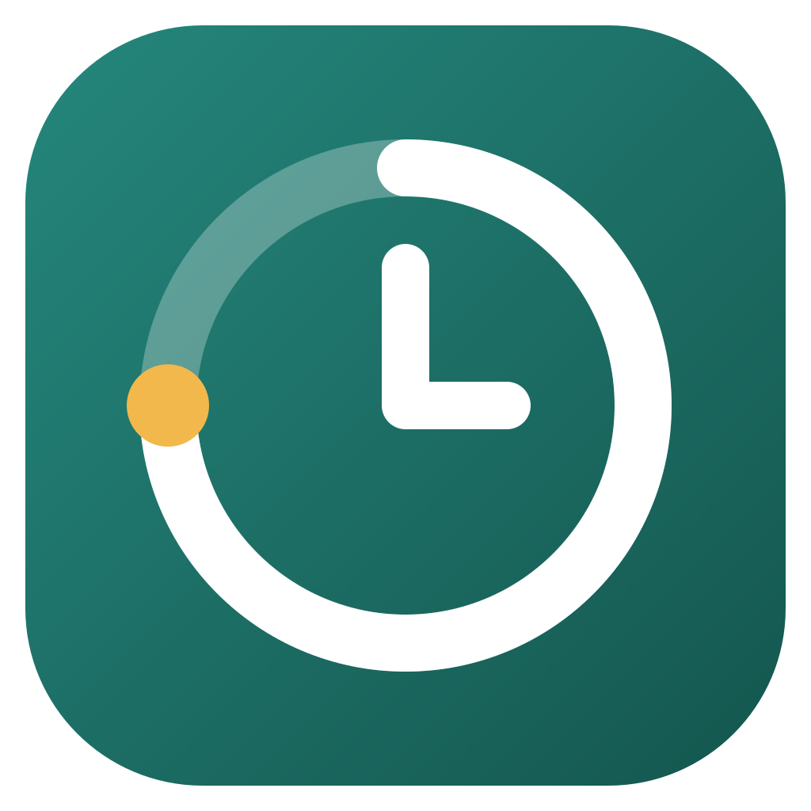
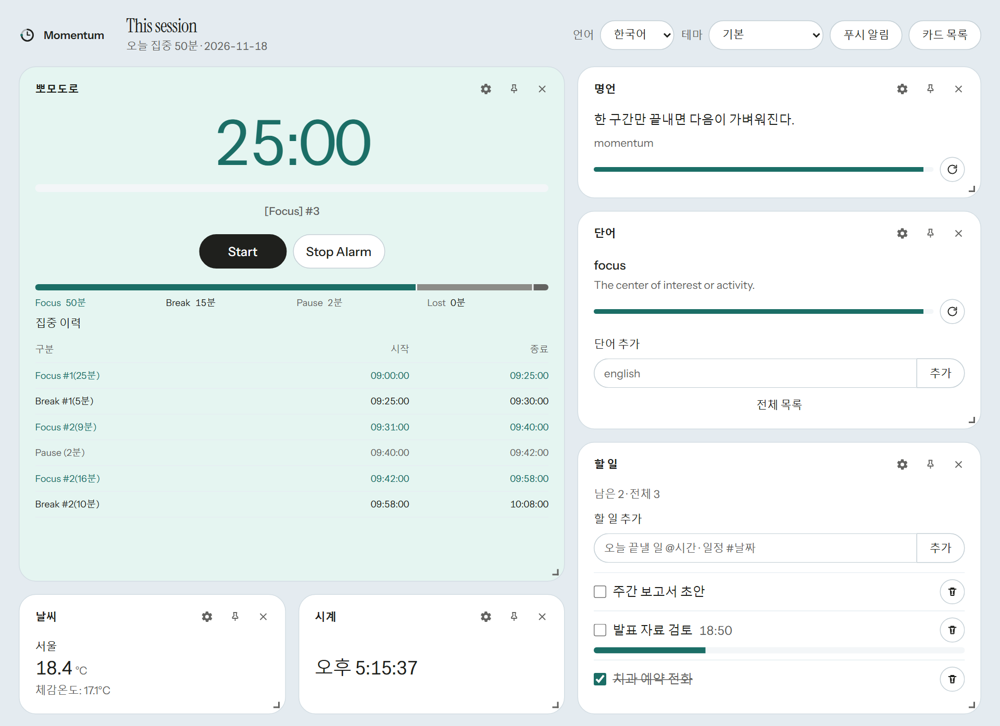
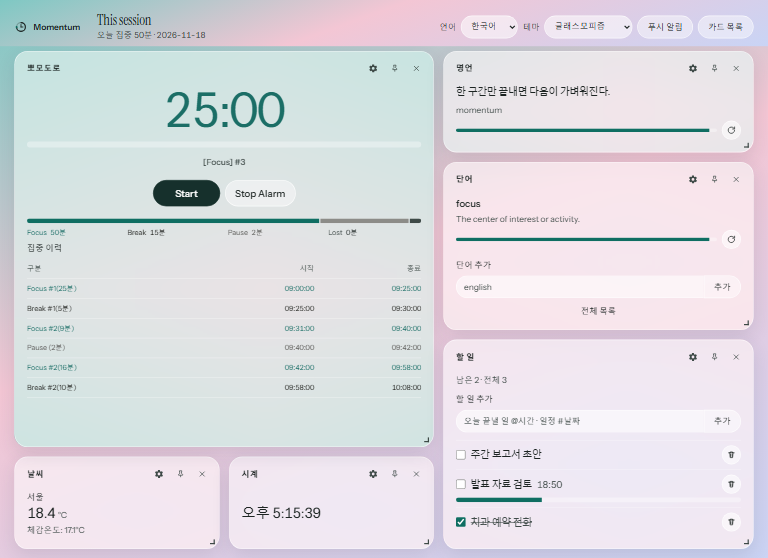
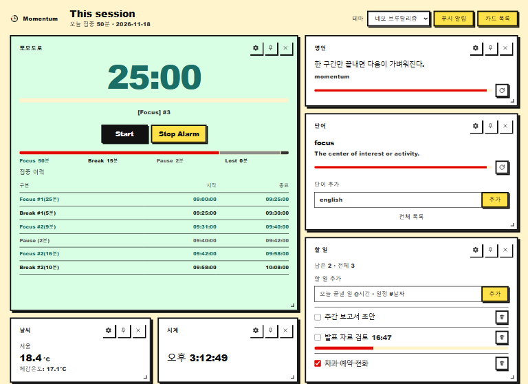
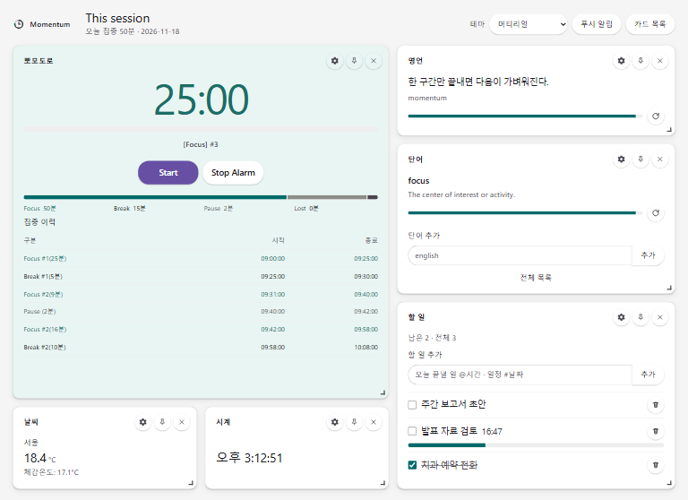

<p align="center">
  <b>한국어</b> · <a href="README.en.md">English</a>
</p>

<p align="center">
  
</p>

<h1 align="center">Momentum</h1>

<p align="center">
  <strong>하루의 집중을 한 화면에.</strong><br>
  뽀모도로, 할 일, 날씨, 시계, 명언, 영어 단어를 카드로 펼쳐 놓는 집중 보드.
</p>

<p align="center">
  <a href="https://elkeipy.github.io/momentum_card/"><b>웹에서 바로 열기</b></a> ·
  <a href="https://github.com/elkeipy/momentum_card/releases/latest">윈도우 앱 받기</a> ·
  <a href="CHANGELOG.md">변경 내역</a>
</p>

<p align="center">
  <a href="https://github.com/elkeipy/momentum_card/actions/workflows/ci.yml"></a>
</p>

<p align="center">
  
</p>

## 왜 Momentum인가

- **가입이 없다.** 계정도 서버도 없다. 카드 배치, 할 일, 집중 기록은 쓰는 브라우저에만 남는다.
- **한 화면에 다 있다.** 집중 타이머와 오늘 할 일, 날씨와 시계가 같은 보드에 있다. 탭을 오가지 않는다.
- **내 방식으로 놓는다.** 카드를 끌어 옮기고 크기를 바꾸고, 필요 없는 카드는 닫는다. 테마는 열 가지다.
- **가볍다.** 작은 정적 페이지다. 윈도우 앱으로 띄워도 이 앱의 프로세스를 다 합쳐 비공유 기준 약 110~130MB였다(개발 PC 한 대에서 잰 값이다).

## 카드

| 카드 | 하는 일 |
|---|---|
| **뽀모도로** | 집중·휴식 타이머와 오늘의 집중 기록. 기본은 집중 25분, 짧은 휴식 5분, 긴 휴식 15분이다. |
| **할 일** | 오늘 끝낼 일을 적는다. `@`로 마감 알림, `#`로 구글 캘린더 일정을 만든다. |
| **날씨** | 현재 위치의 도시, 기온, 체감온도를 한 시간마다 새로 받는다. |
| **시계** | 이 기기의 시각을 보여 준다. |
| **명언** | 짧은 문장 다섯 개를 1분마다 바꾼다. 새로고침으로 바로 넘긴다. |
| **단어** | 영어 단어와 뜻을 1분마다 무작위로 보여 준다. 목록은 최대 20개다. |

카드 헤더의 톱니에서 글자 크기를 바꾼다. −/+로 값을 올리면 저장 전에 카드에 미리 보인다. 명언과 단어는 새로고침 간격도 바꾼다.

## 뽀모도로: 집중이 어떻게 쓰였는지 남긴다

- **구간을 내 리듬에 맞춘다.** 톱니바퀴에서 집중 1–60분, 휴식 1–30분, 긴 휴식 간격 1–10번을 고른다. 긴 휴식은 집중 4번마다 온다(기본값).
- **멈춰도 이어진다.** Pause는 남은 시간을 그대로 두고, Start는 그 자리에서 잇는다. 시간 아래 막대는 구간이 지날수록 차고, Pause면 그 자리에서 멈춘다.
- **끝나도 시간은 센다.** 타이머가 0이 되면 `+분:초`로 지나간 시간을 센다. 1분이 지나도 시작하지 않으면 그 시간은 **Lost**로 기록된다.
- **하루가 한 줄로 보인다.** 오늘의 Focus, Break, Pause, Lost가 색이 다른 한 트랙으로 나뉘고, 그 아래에 구간 목록이 있다.

  ```
  Focus #1(25분)   Break #1(5분)   Focus #2(9분)   Pause (2분)   Focus #2(16분)   Lost (10초)
  ```

  Focus와 Break에는 오늘 몇 번째 텀인지와 길이가, Pause와 Lost에는 길이가 붙는다. Pause로 끊긴 텀은 같은 번호를 쓴다. 1분까지는 초로, 넘으면 `1분2초`처럼 적는다. Focus나 Break 도중 Pause한 시간은 그 텀이 끝날 때 함께 남는다.
- **한눈에 구분한다.** 카드 배경이 Focus, Break, Lost에 따라 달라진다. Focus, Break, Pause, Lost의 글자색을 골라 타이머와 이력에 입힌다.
- **카드를 키우면 이력이 늘어난다.** 타이머는 그대로이고 이력 표만 길어진다.

## 할 일: 적으면서 마감과 일정이 된다

- **`@`로 마감을 건다.** 입력에 `@`를 넣으면 마감 시/분을 고른다. 지금보다 이른 시각은 넣을 수 없다. 마감이 있는 항목은 아래에 막대가 차오르고, 시간이 됐는데 끝나지 않으면 막대가 붉어지며 우측 하단에 알림이 쌓이고 Mixkit 알림음이 난다.
- **`#`로 일정을 만든다.** 입력에 `#`를 넣고 날짜와 시각(비우면 종일)을 고른 뒤 **캘린더에 추가**를 누르면 구글 캘린더 일정 작성 화면이 열린다. 이 브라우저에 로그인된 계정에 제목과 시간이 채워져 뜨고, 저장은 직접 누른다. 일정은 할 일 목록에 쌓이지 않고, 앱은 구글 계정에 접근하지 않는다.
- **편하게 고친다.** 글자를 더블 클릭하면 그 줄에서 바로 고친다. Enter로 저장하고 Esc로 취소한다. 긴 글은 말줄임이고 올리면 전체가 보인다. 지우기는 휴지통 버튼이다. 목록은 최대 40개다.

## 폰으로도 알림을 받는다

우상단 **푸시 알림**에 [ntfy](https://ntfy.sh) 토픽을 넣으면, 뽀모도로가 끝나거나 할 일 마감이 됐을 때 `https://ntfy.sh/<토픽>`으로 한 줄을 보낸다. 폰의 ntfy 앱(또는 ntfy.sh/app)에서 같은 토픽을 구독하면 된다. 보드 탭이 열려 있을 때만 나가고, 토픽 이름이 비밀번호이니 길게 잡는다.

## 보드를 내 방식으로

- **끌고, 늘리고, 붙인다.** 헤더를 끌어 옮기고 오른쪽 아래 모서리로 크기를 바꾼다. 다른 카드의 변이나 그 옆 간격 자리에서 8px 안에 들면 그 선에 붙는다. 위치는 남는다.
- **고정하고, 닫고, 다시 켠다.** 핀을 누르면 이동과 크기 변경이 잠긴다. 닫으면 화면에서만 빠지고, 우상단 **카드 목록**에서 다시 켠다. 켜면 그 카드가 맨 앞으로 온다.
- **테마 열 가지.** 기본, 스큐어모피즘, 플랫, 머티리얼, 뉴모피즘, 글래스모피즘, 클레이모피즘, 네오 브루탈리즘, 리퀴드 글래스, 3D 아이콘. 고른 테마는 남는다.

| 글래스모피즘 | 네오 브루탈리즘 | 머티리얼 |
|:---:|:---:|:---:|
|  |  |  |

### 단축키

| 키 | 동작 |
|---|---|
| `Alt+S` | 뽀모도로 시작/일시정지 |
| `Alt+A` | 뽀모도로 알림음 끄기 |
| `Alt+T` | 할 일 추가 칸에 커서 |
| `Esc` | 설정 창, 카드 목록 닫기. 할 일 고치기 취소 |

## 내 데이터는 내 것

계정은 없다. 카드 배치, 보이는 카드, 타이머 설정, 오늘 집중 기록, 단어 목록, 할 일, ntfy 토픽, 테마는 모두 이 브라우저의 `localStorage`에만 있다. 다른 기기와는 동기화되지 않는다.

밖으로 나가는 요청은 이것뿐이다.

| 요청 | 언제 | 보내는 것 |
|---|---|---|
| `api.open-meteo.com` | 날씨 카드 | 소수점 둘째 자리로 줄인 위도·경도 |
| `api.bigdatacloud.net` | 날씨 카드 | 같은 위도·경도 (도시 이름을 받는다) |
| `api.dictionaryapi.dev` | 단어 카드 | 보여 줄 영어 단어 |
| `ntfy.sh` | 푸시 알림을 켰을 때만 | 알림 한 줄 |
| Google Fonts | 페이지를 열 때 | 글꼴 파일 요청 |

## 시작하기

### 웹

[elkeipy.github.io/momentum_card](https://elkeipy.github.io/momentum_card/)를 열면 된다. 날씨 카드는 위치 권한을 한 번 묻는다.

### 윈도우 앱

크롬 없이 작은 창으로 띄우는 Tauri 앱이다. [Releases](https://github.com/elkeipy/momentum_card/releases/latest)의 Assets에서 `momentum.exe`를 받아 실행한다. 설치가 필요 없다.

- 윈도우에 깔린 WebView2가 배포 주소를 그대로 열기 때문에 사이트가 갱신되면 앱도 최신이 된다. 인터넷이 끊기면 화면이 뜨지 않는다. WebView2 런타임이 필요하다(윈도우 11에는 기본으로 깔려 있다).
- 창 크기와 위치는 정상으로 닫을 때 저장하고 다시 켜면 그대로 뜬다. 최대화한 채 닫으면 최대화로 뜬다.
- 구글 캘린더 일정 작성 화면은 PC 기본 브라우저에서 연다. 그 브라우저에 로그인된 계정으로 뜬다. 다른 새 창은 열지 않는다.
- 위치 권한은 앱 주소가 보내는 요청만 허용한다. 윈도우 설정에서 위치 서비스가 꺼져 있으면 날씨가 뜨지 않는다. 배포 사이트에는 앱 기능을 부르는 권한을 주지 않는다.
- 카드 배치, 할 일, 집중 기록, 테마, ntfy 토픽은 앱 전용 저장소에 따로 쌓인다. 크롬에 있던 것은 옮겨지지 않는다.
- 서명하지 않은 파일이라 처음 실행할 때 SmartScreen이 막으면 `추가 정보`, `실행`을 누른다. 릴리스 노트에 SHA256이 있다.

### 자주 묻는 질문

<details>
<summary><b>폰이나 다른 PC와 동기화되나요?</b></summary>

아니다. 데이터는 그 브라우저(또는 앱)에만 있다. 폰에서는 ntfy 알림으로 마감과 구간 종료를 받는다.
</details>

<details>
<summary><b>인터넷이 없어도 쓸 수 있나요?</b></summary>

오프라인 동작은 지원하지 않는다. 페이지를 열 때와 날씨·단어 뜻을 받을 때 인터넷이 필요하다.
</details>

<details>
<summary><b>구글 계정 정보를 가져가나요?</b></summary>

아니다. 앱은 구글 계정에 접근하지 않는다. 일정은 구글 캘린더 일정 작성 화면을 여는 것으로 끝나고, 어느 계정에 저장할지는 열린 화면에서 직접 정한다.
</details>

---

## 개발

```bash
npm install
npm start
```

개발 주소는 http://localhost:3000/momentum_card 이다.

```bash
npm test
npm run typecheck
npm run test:e2e
npm run deploy
```

`npm run deploy`는 빌드한 뒤 GitHub Pages에 올린다.

푸시와 PR마다 GitHub Actions가 타입체크, 단위 테스트, 빌드를 돈다(`.github/workflows/ci.yml`). Dependabot PR도 master로 머지하기 전에 이 검사를 거친다.

### 데스크톱 앱 빌드

직접 빌드하려면 Rust와 Visual Studio C++ 빌드 도구, WebView2가 필요하다.

```bash
npm run tauri build -- --no-bundle
```

`src-tauri/target/release/momentum.exe`가 생긴다. 환경 변수 `MOMENTUM_URL`에 주소를 주고 실행하면 배포 주소 대신 그 주소를 연다. 그 주소의 위치 요청도 허용한다.

### 아이콘

원본은 `public/favicon.svg` 한 파일이다. 고친 뒤 `npm run icons`를 실행하면 탭 아이콘, 매니페스트용 PNG, 앱 아이콘을 모두 다시 만든다.
